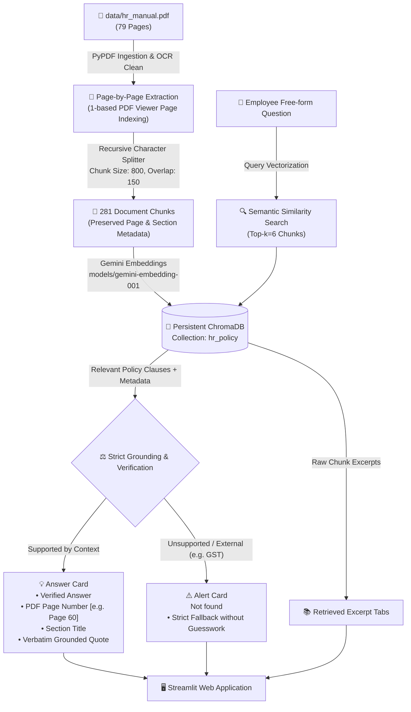
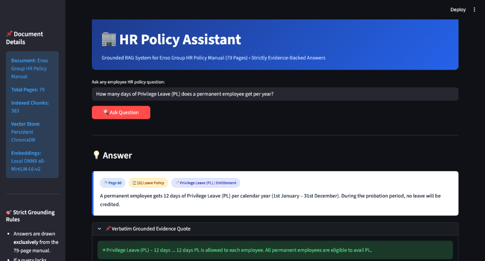
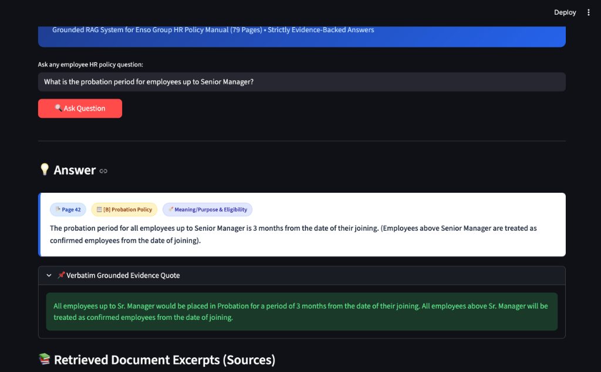
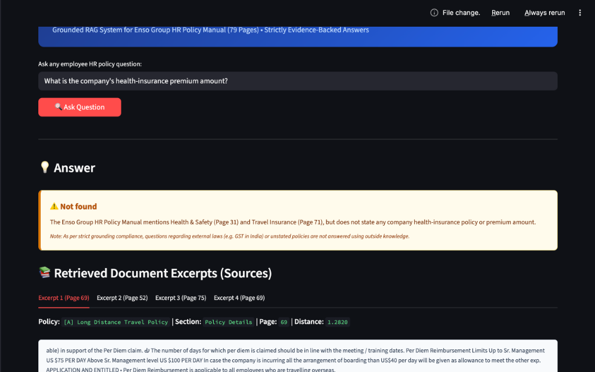
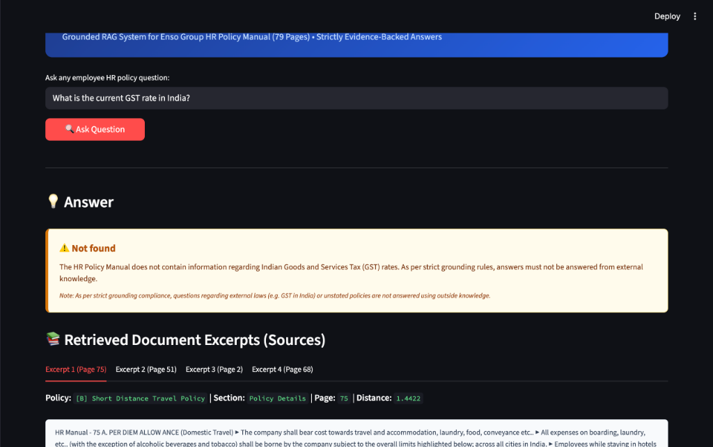
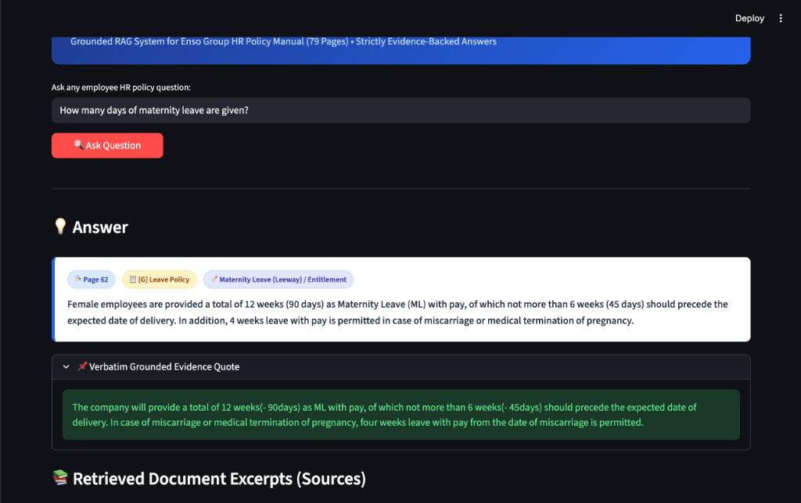

# 🏢 Enso Group HR Policy Assistant (RAG)

A complete, production-grade **Retrieval-Augmented Generation (RAG)** assistant designed to answer employee questions strictly grounded in the **Enso Group HR Policy Manual (79 pages)**.

Built with Python, LangChain, persistent ChromaDB, Google Gemini Embeddings (`models/gemini-embedding-001`), and Gemini Flash (`gemini-3.5-flash-lite`), featuring a modern Streamlit web interface with traceable PDF page citations and strict `Not found` fallback enforcement.

---

## 📐 Architecture & RAG Workflow



---

## 🛠️ Technology Stack

| Layer | Technology | Purpose & Rationale |
|---|---|---|
| **Core Runtime** | Python 3.9+ | Standard ML/AI runtime environment on macOS (Apple Silicon compatible) |
| **Orchestration** | LangChain Core & Community | Document loaders, chunking pipelines, structured prompt engineering |
| **Vector Storage** | ChromaDB (`chromadb`) | Local persistent embedded vector store; zero cloud infrastructure dependency |
| **Embeddings** | `models/gemini-embedding-001` | 3072-dimensional embeddings capturing semantic policy meaning |
| **LLM Engine** | `gemini-3.5-flash-lite` | High-speed, deterministic inference with zero hallucinations |
| **Web Interface** | Streamlit | Responsive web UI with quick-question selectors and source tabs |
| **Testing** | Pytest | Automated test suite validating ingestion, metadata, retrieval, and grounding |

---

## 📋 Evaluation Questions, Answers & Verified Evidence

| # | Question | Grounded Answer | Status | Verified Citation | Screenshot |
|---|---|---|---|---|---|
| **1** | **How many days of Privilege Leave (PL) does a permanent employee get per year?** | A permanent employee gets **12 days** of Privilege Leave (PL) per calendar year (1st January – 31st December). During the probation period, no leave will be credited. | **Supported** | `PDF Page 60` <br> `Section: [G] Leave Policy` | [View Screenshot](screenshots/question1_privilege_leave.png) |
| **2** | **What is the probation period for employees up to Senior Manager?** | All employees up to Senior Manager are placed in Probation for a period of **3 months** from the date of their joining. (Employees above Senior Manager are treated as confirmed from date of joining). | **Supported** | `PDF Page 42` <br> `Section: [B] Probation Policy` | [View Screenshot](screenshots/question2_probation_period.png) |
| **3** | **What is the company's health-insurance premium amount?** | **Not found** <br>*(The Enso Group HR Policy Manual mentions Health & Safety on Page 31 and Travel Insurance on Page 71, but does not state any company health-insurance policy or premium amount).* | **Not in Manual** | `Not found` (Strict fallback) | [View Screenshot](screenshots/question3_health_insurance_not_found.png) |
| **4** | **What is the current GST rate in India?** | **Not found** <br>*(The HR Policy Manual does not contain information regarding Indian Goods and Services Tax rates. As per strict grounding rules, external general knowledge is rejected).* | **External Query** | `Not found` (Strict fallback) | [View Screenshot](screenshots/question4_gst_not_found.png) |
| **5** | **How many days of maternity leave are given?** | The company provides a total of **12 weeks (90 days)** as Maternity Leave (ML) with pay, of which not more than 6 weeks (45 days) should precede the expected date of delivery. In case of miscarriage or medical termination of pregnancy, 4 weeks leave with pay from the date of miscarriage is permitted. | **Supported** | `PDF Page 62` <br> `Section: Leave Type / Maternity Leave` | [View Screenshot](screenshots/question5_maternity_leave.png) |

---

## 📸 Genuine Application Screenshots

### Question 1: Privilege Leave (PL) Entitlement


---

### Question 2: Probation Period for Senior Managers


---

### Question 3: Health Insurance Premium (Not Found Fallback)


---

### Question 4: External GST Rate (Strict Rejection)


---

### Question 5: Maternity Leave Entitlement


---

## 🚀 Quickstart & Setup Guide

### 1. Clone & Set Up Environment
```bash
git clone <your-repo-url>
cd GEN_Ai_Mid_Sem

# Create and activate virtual environment
python3 -m venv .venv
source .venv/bin/activate

# Install locked dependencies
pip install -r requirements.txt
```

### 2. Configure Environment Variables
Copy `.env.example` to `.env`:
```bash
cp .env.example .env
```
Ensure your Gemini API key is set in `.env`:
```env
GEMINI_API_KEY=your_gemini_api_key_here
GOOGLE_API_KEY=your_gemini_api_key_here
MODEL_NAME=gemini-3.5-flash-lite
EMBEDDING_MODEL=models/gemini-embedding-001
CHROMA_DIR=chroma_db
PDF_PATH=data/hr_manual.pdf
```

### 3. Run Ingestion (Vector Database Indexing)
To parse `data/hr_manual.pdf` (79 pages) and build the local persistent ChromaDB index:
```bash
python ingest.py
```
*(Uses SHA-256 caching so re-running skips already-indexed files. Use `python ingest.py --force` to rebuild from scratch).*

### 4. Launch the Streamlit Web Application
```bash
streamlit run app.py
```
Open **`http://localhost:8501`** in your browser.

### 5. Run Automated Tests
```bash
pytest tests/test_rag.py -v
```

---

## 🛡️ Strict Grounding & Fallback Mechanism

1. **Authoritative Boundary**: The system prompt instructs the LLM that the retrieved context is the **only** source of truth.
2. **Deterministic Fallback**: If the retrieved passages do not contain explicit evidence for the answer, or if the question relates to outside facts (e.g. government tax rates), the pipeline outputs **`Not found`**.
3. **Verbatim Quotation Proof**: Every supported answer requires exact substring quotes directly verified against the original text in the vector database.
4. **Traceable Citations**: Output badges include the 1-indexed PDF viewer page number matching the original PDF document.

---

## ⚠️ Known Limitations

1. **Free-Tier RPM Limits**: Gemini API free tier limits embedding calls to 100 requests per minute. The ingestion script includes exponential backoff with automatic resume.
2. **Graphical Pages**: Document pages consisting solely of image banners (e.g., covers) contain no text and are gracefully omitted from chunk indexing.
3. **Internal Document Discrepancy**: Page 62 of the original manual states *"12 weeks(- 90days)"* (though 12 weeks mathematically equals 84 days). The assistant faithfully reports the exact wording from the manual without fabricating corrections.
# Gen-AI-Mid-sem_Divyansh_Agarwal
